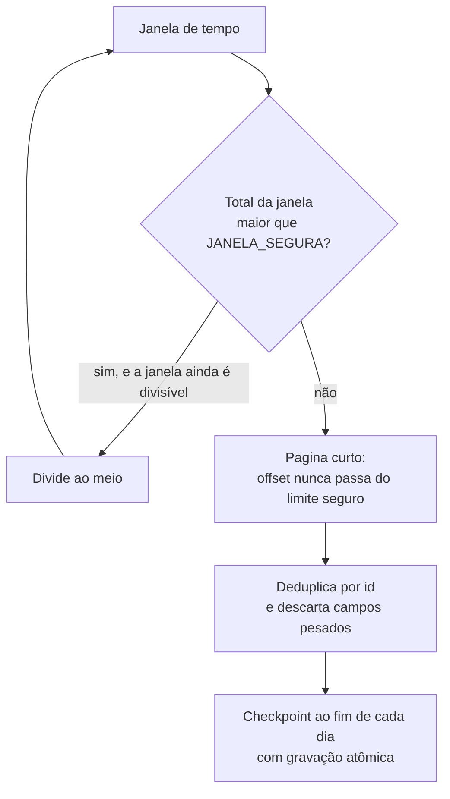

# Coleta adaptativa de APIs paginadas

Extrai centenas de milhares de registros de uma API REST paginada **sem perder nem duplicar linhas**, mesmo quando a
API desanda com offset alto. Em vez de paginar fundo, a coleta divide o período em janelas de tempo cada vez menores,
até cada uma caber numa paginação curta e confiável.

> Versão genérica de uma solução que roda em produção no relatório mensal de disparos de WhatsApp de uma operadora de
> plano de saúde (~330 mil mensagens por mês). Não tem código, dado nem credencial do cliente: a API de exemplo
> incluída reproduz os mesmos defeitos com dados fictícios.

## O problema

O relatório vinha de um notebook que falhava todo mês:

| Sintoma | Causa |
|---|---|
| Linhas duplicadas e linhas faltando em volume alto | A API limita 50 registros por página e, com `_offset` alto, a ordem fica instável: uma página repete parte da anterior e pula outras |
| `401` no meio da coleta | Cookie de sessão colado à mão, que expirava |
| Relatório zerado de um mês para o outro | Filtro com o nome exato do template, que mudava a cada renomeação |
| Processo morto por falta de memória | Cada registro trazia um esquema de campos pesado; o mês inteiro chegou a 14,8 GB de RAM |

## Como resolve



- **Janela adaptativa.** Lê o total da janela na primeira página. Se for grande, divide em duas e repete. Assim o
  offset fica sempre na faixa em que a API é confiável. A deduplicação por `id` fica só como rede de segurança.
- **Retomável.** Cada dia concluído é salvo. Se a rodada cair, a próxima continua do último dia, sem recomeçar.
- **Gravação atômica.** Grava num `.tmp` registro a registro e só então troca pelo arquivo final. Se o processo
  morrer no meio, o arquivo anterior continua inteiro.
- **Memória enxuta.** Descarta na entrada os campos que o relatório não usa (`DESCARTAR_CAMPOS`).
- **Login programático.** Faz login com e-mail e senha (ou usa um token fixo) em vez de depender de cookie colado.
- **Filtro por prefixo.** `TEMPLATES_PREFIXOS=status_pedido_` aceita `status_pedido_v1` e também os nomes que vierem
  depois. O comando `templates` mostra o que apareceu no período antes de gerar o relatório.
- **Enriquecimento em paralelo.** Busca o texto real de cada mensagem com várias requisições ao mesmo tempo, guarda em
  cache e, se algo falhar, a próxima rodada busca só o que faltou.
- **Respeita a API.** Repete com espera crescente em `429` e `5xx` e obedece o `Retry-After`.

## Resultado em produção

- Zero linhas duplicadas ou faltando desde a troca, conferido contra o total informado pela própria API.
- Pico de memória de 14,8 GB para cerca de 0,5 GB num mês inteiro.
- As trocas de nome de template dos meses seguintes (inclusive um template único virando três) entraram no relatório
  sem mudar uma linha de código.
- Um mês de ~300 mil registros: ~1h20 de coleta e ~1h45 de enriquecimento (cerca de 50 requisições por segundo),
  com um único comando.

## Rodando localmente

Requer Python 3.10+.

```bash
python -m venv .venv && source .venv/bin/activate
pip install -r requirements.txt
cp .env.example .env

python mock_api.py          # terminal 1: API de exemplo em http://127.0.0.1:8765
```

Em outro terminal, compare a paginação comum com a adaptativa:

```bash
python coleta.py comparar --inicio 2026-10-01 --fim 2026-10-10
```

```text
Total informado pela API .......    15.152
Ingênuo (offset fundo) .........    14.378 únicos · 772 duplicados · 774 faltando · 2.0s
Adaptativo (janelas) ...........    15.152 únicos · 0 duplicados · 0 faltando · 2.1s
```

E rode a pipeline completa:

```bash
python coleta.py run --inicio 2026-10-01 --fim 2026-10-10
```

O resultado fica em `saida/`: o arquivo bruto, o cache de mensagens e `relatorio_<período>.xlsx`, com as abas
**Resumo**, **Por template** e **Registros**.

## Comandos

| Comando | O que faz |
|---|---|
| `coletar` | Coleta o período com janela adaptativa. Retoma do último dia concluído. |
| `templates` | Lista os templates do período com contagem e marca os que entram no filtro. |
| `enriquecer` | Busca o texto real de cada mensagem em paralelo, com cache. |
| `gerar` | Gera o XLSX a partir do bruto e do cache. |
| `run` | `coletar` + `enriquecer` + `gerar`. |
| `comparar` | Mostra quantos registros a paginação comum perde e duplica. |

Período: `--inicio AAAA-MM-DD --fim AAAA-MM-DD` (o fim entra) ou `--mes-passado`.

## Adaptar para outra API

O formato da API fica isolado em três funções de `coleta.py`. Ajuste-as junto com as variáveis `ENDPOINT_*` do `.env`:

- `buscar_pagina()`: parâmetros de período e paginação e onde vêm os registros e o total;
- `extrair_mensagem()`: de onde sai o texto no detalhe do registro;
- `montar_linha()`: colunas do relatório.

Os limites ficam no `.env`: `PAGE_LIMIT` (teto da página), `JANELA_SEGURA` (até onde paginar sem dividir) e
`JANELA_MIN_SEG` (menor janela permitida).

## Estrutura

```text
coleta.py          coleta, enriquecimento, relatório e comparação (CLI)
mock_api.py        API de exemplo com os mesmos defeitos da original, dados fictícios
tests/             testes ponta a ponta contra a API de exemplo
.env.example       configuração comentada
```

## Testes

```bash
python -m unittest discover -s tests -v
```

Os testes sobem a API de exemplo numa porta livre e conferem que a paginação comum perde e duplica registros, que a
adaptativa traz exatamente o total, que uma coleta interrompida retoma sem duplicar e que o relatório é gerado.

## Licença

MIT
